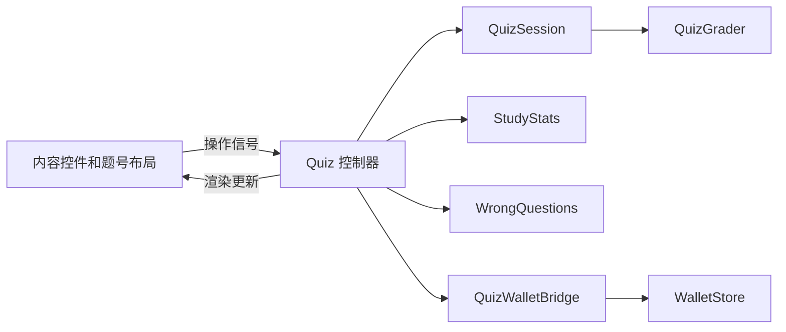

# Godot 客户端架构

本说明覆盖根目录 `project.godot` 对应的客户端。功能重构保留原题目 ID、存档路径和账号分区规则。

## 初始化与生命周期

- `AppState`：当前课程/练习入口、显示偏好、全局快捷键、窗口初始化及编程草稿。
- `StudyStats`：题库统一加载/校验/题型分组、学习记录、继续学习位置。
- `ProfileStore`：宿主提供的账号会话与资料状态；持有资料保存快照、请求标识和待核实结果，弹窗关闭不取消已经发出的保存。
- `AppServices`：按需创建并持有 `CollectionStore`、`SocialStore`、`WalletStore`、`WrongQuestions`。这些服务独立于页面和路由缓存生存。
- `CardDrawStore`：同由 AppServices 持有，管理每次 200 电池获取卡牌的持久请求与结果核实；服务返回后合并 WalletStore 及 CollectionStore 的权威快照，展示控件仍只负责原有 CardReveal 动画。
- `PageRouter`：页面切换、返回层级、缓存和公共侧栏；不再创建或持有业务 Store。
- `UiResources`：字体、主题资源、纹理缓存和滚动条显示策略。
- `UiMotion`：过渡动画的执行、取消、离树清理和减少动态效果设置。

PC 正常启动时，`BackendProvider` 启用登录要求，显示原有账号窗口并暂停当前页面的输入处理。`PageRouter.login_guard` 将页面跳转保留到认证完成后执行；取消必需的登录直接退出进程。登录成功恢复页面处理，退出登录或会话失效重新加锁。认证请求和加密凭证仍由原提供者管理，窗口只返回带 `cancelled` 标识的取消结果；不新增说明页或退出确认框。专用工具和隔离测试不自动接入真实登录。

取得业务服务使用 `/root/AppServices`，不能通过路由器或某个页面查找业务 Store。账号切换仍由 `ProfileStore` 发出会话变化，业务状态各自处理过期请求与账号分区。

## 答题链路



- `quiz_session.gd` 是不依赖场景树的 `RefCounted`：维护当前题、选项乱序、未提交草稿、重做题和已答状态。
- `quiz_grader.gd` 是纯判题模块，继续复用 `FillAnswer`、`OutputAnswer` 的规范化规则。
- `quiz.gd` 接收操作信号，协调会话、存档、统计、奖励及导航；不定义控件样式或具体判题规则。
- `quiz_content_view.gd` 创建和更新题干、选项、填空、输出及代码控件。用户操作通过信号传给控制器。
- `minimal_quiz_view.gd` 负责页面布局、题号虚拟化、F6 专注模式、计时及右栏视图组装。标记与讨论分别从 AppServices 取得 QuizMarks / BankDiscussions，仍不承担判题。
- `quiz_right_panes.gd` 仅负责固定右栏内的可中断过渡和输入/焦点管理；`bank_discussion_view.gd` 是原生评论控件，`bank_discussion_store.gd` 持有按会话和题库隔离的网络、草稿、分页及请求序列。`quiz_marks.gd` 使用 LocalJsonStore 单独保存稳定题目标记。
- `quiz_wallet_bridge.gd` 读取会话答案并对接奖励服务，通过 `feedback_changed` 发出反馈，不直接改界面控件。

控制器保留了已有集成检查使用的属性访问器；新增界面组件应接入会话/内容视图和信号，不依赖控制器的内部方法。

## 共用赠送组件

`CollectionGiftDialog.configure(host, collection_store, card_id, friend)` 是统一入口。

好友页传入空的 `card_id` 时，窗口在卡图摘要中提供可赠卡牌选择并预选传入好友；收藏页传入具体卡牌 ID 时仍固定该卡。两个入口共用同一表单、数量与提交逻辑，好友页不再先打开旧的文字选卡窗口。

- `host` 只提供遮罩所在的普通 `Control`，不要求宿主实现任何收藏页面内部方法。
- 卡图、比例和系列名称由 `CardArtwork` 统一生成。
- 赠送资格、库存、请求和恢复属于 `CollectionStore`；窗口只显示状态与提交操作。
- `closed` 负责关闭后的页面恢复，`retiring(window)` 是可选的退出动画事件。
- 好友页面和收藏页面使用同一个窗口，不再通过空方法模拟另一种页面。

## 样式与动效

`UiTokens` 保存品牌色和时长；`UiStyles` 保存组件样式、配色变体、按钮/输入框焦点规则、代码控件及菜单外观。

圆角弹窗统一通过 `UiStyles.dialog_panel()` 设置透明窗口底色、无系统外框和无外层描边的面板；标题与关闭操作由弹窗内容提供。主题切换同样复用该入口，避免圆角外重新露出矩形底色。嵌入窗口额外通过 `DialogSurface` 保留圆角边缘的直通 RGB/Alpha，透明像素的 Alpha 始终为 0，避免合成时重复乘透明度及缩放采样黑色形成暗线；原生窗口不应用此转换。验收使用 `check_dialog_compositing.gd --visual` 对最终主窗口合成结果与真实遮罩背景逐像素比较，不能只检查子窗口纹理的四角。

`AccountDialogUi` 仅供资料编辑和账号表单复用标签、关闭/显隐图标、按钮与页面缩放；不调整其他页面布局。`BackendProvider` 打开账号表单时暂时隐藏来源弹窗和遮罩，结束后按原流程恢复，并以会话 epoch 拒绝旧认证结果。

页面负责布局尺寸与业务状态，基础页面的 `_style()`、`_style_button()` 是对 `UiStyles` 的兼容包装。`UiFeedback` 负责组合悬停、按下、禁用等状态并驱动过渡，不再自行定义焦点边框。按钮焦点仍可供键盘导航使用，但不绘制蓝色焦点框。

## 本地数据边界

- `LocalJsonStore.read/write` 是 JSON 存档的统一磁盘入口。
- 写入先完成同目录临时文件、flush 与关闭，再替换目标；失败返回错误，保留原存档。
- `WrongQuestions` 统一读写课程错题 ID，并通过 `changed(subject)` 通知页面。
- 页面不再自行解析错题 JSON，答题控制器也不直接写错题文件。
- 学习统计、编程草稿、收藏标记/赠送请求、社交偏好和钱包请求保留各自的 schema 与存档路径，共用原子写入策略。
- `LocalLoginStore` 在 `user://last_login_v1/` 按服务地址隔离上次登录记录。Windows 凭证通过 `WindowsDataProtection` 使用当前系统用户的 DPAPI 保护；密码不落盘。快捷入口先在线验证原会话，再由 `BackendProvider` 接入 `ProfileStore`，不以本地记录直接建立登录态。
- 题库 JSON 是只读内容资源，仍由加载器校验；Python 运行器的程序文件和输出文件不是 JSON 存档。

## 旧数据兼容

失效的 `MySpirit.tscn` 和只供它使用的旧主题已经移除。旧精灵计时、经验计算和定时写盘不再运行。

`LegacySaveMigration` 只负责旧应用目录中的一次性文件导入。已有 `spirit_progress.json` 保留为历史记录，不在正常运行或退出时覆盖。题库、学习记录、错题和编程草稿继续使用原有标识。

## 验证

使用隔离存档运行：

```text
py -3 tools/run_workbench_checks.py --godot <Godot控制台程序> --script check_architecture_boundaries.gd
```

该检查覆盖独立会话的判题/草稿/重做、共享题库不被修改、真实临时文件写入失败保护、业务服务生命周期和场景资源解析。功能回归继续使用题型顺序、答题重做布局、页面缓存、返回导航、动效、收藏、头像、个人中心、好友、充值及订单恢复检查。


## PC / 移动端本地学习共用核心（2026-11-04）

判题、刷题会话、题库加载、手动收藏、学习计数与本地 JSON 写入由 `scripts/fill_answer.gd`、`output_answer.gd`、`quiz_grader.gd`、`quiz_session.gd`、`question_bank.gd`、`manual_question_collection.gd`、`study_record.gd`、`local_json_store.gd` 维护。PC 的 `StudyStats` 和 `WrongQuestionStore` 委托这些模块，保留原接口与数据格式。移动项目通过 `mobile/tools/sync_pc_learning.py` 同步相同源文件并记录哈希，不另写判题或计数规则。核心仅在设备本地执行，不增加服务器实例或数据库。旧 PC 包装层与新实现的题库、学习统计及收藏格式已做隔离对照验证。
